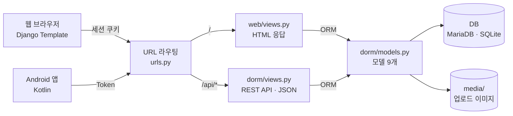

# 🏠 돔고돔락(DORM苦DORM樂)
기숙사의 원활한 관리를 위한 통합 관리 시스템

---

실제 구현 이미지


---

## 📌 프로젝트 소개
돔고돔락은 학생과 관리자가 웹과 모바일 환경에서 기숙사 생활을 통합적으로 관리할 수 있는 플랫폼입니다.  
외출 신청, 상벌점 관리, 공지사항, 문의, 게시판 등 다양한 기능을 하나의 시스템에서 제공합니다.

---

## 🧭 시스템 구조

웹과 Android 앱이 하나의 Django 서버와 DB를 함께 씁니다. `/api/`로 들어온 요청은 REST API(JSON)가, 나머지 요청은 Django Template 화면(HTML)이 처리합니다.



요청 처리 순서, 입실·외박·문의 업무 흐름, 데이터 구조, 페이지·API 권한은 [흐름도](/docs/flowchart.html)에 정리했습니다.

---

## 🛡️ 코드 점검 및 개선 (프로젝트 종료 후)

완성된 코드를 다시 점검해서 **보안 취약점 6건**과 기능 오류를 찾아 고쳤습니다. 문제마다 실제 요청으로 재현한 뒤 실패하는 테스트를 먼저 작성했고, 고친 내용은 PR 하나씩으로 나눠 머지했습니다. 테스트는 **0개에서 61개**로 늘었습니다.

| 구분 | 발견한 문제 | 조치 | PR |
|---|---|---|---|
| 보안 | 로그인하지 않아도 다른 사람의 문의를 API로 열람 | 작성자·관리자만 조회하도록 권한 클래스 수정 | #9 |
| 보안 | 비로그인 사용자도 학생 상벌점 변경 가능 | 관리자 권한 검사 추가 | #1 |
| 보안 | 외박 승인, 댓글 삭제가 GET 링크로도 실행 | 상태를 바꾸는 요청은 POST만 허용 | #2 |
| 보안 | 공지 이미지 칸에 스크립트가 든 HTML 파일 업로드 가능 | Pillow로 이미지 파일인지 검증 | #10 |
| 보안 | 다른 학생 명의로 외박 신청 가능 (웹·API) | 신청서 이름·학번을 로그인 계정과 대조 | #11 |
| 보안 | 관리자 검색으로 비밀번호 해시를 조건 검색 가능 | 검색 가능한 필드를 화면 항목으로 제한 | #12 |
| 오류 | 웹에서 문의 등록이 저장되지 않음 | 마이페이지 POST 처리 추가 | #4 |
| 오류 | 학번 중복·잘못된 입력에서 500 에러 (6곳) | 저장 전 검증하고 오류 메시지 표시 | #3, #13 |
| 오류 | 로그인 페이지 경로 미설정으로 404, 로그인 후 원래 페이지로 못 돌아감 | `LOGIN_URL`, 안전한 `next` 처리 | #3, #6 |
| 설정 | `SECRET_KEY`가 공개 저장소에 노출 | 환경변수로 분리하고 키 교체 | #21 |
| 구조 | 상단 메뉴가 템플릿 18개에 복사되어 페이지마다 달라짐 | 공통 템플릿으로 분리 (1,564줄 삭제), 90개 화면 전후 비교로 검증 | #22, #23 |

**진행 방식:** 권한·입력 검증 지점 코드 리뷰 → 롤백 트랜잭션으로 실제 요청 재현 → 실패 테스트 작성 → 수정 → 테스트 통과 확인 → PR 머지

자세한 내용은 [변경이력](/CHANGELOG.md)과 각 PR에 정리했습니다.

---

## 🛠 기술 스택

### Backend
- Django
- Django REST Framework

### Frontend
- HTML5
- Django Template
- Bootstrap
- JavaScript
- UI 기반: [FreeHTML5.co](https://freehtml5.co/) 무료 템플릿 ([CC BY 3.0](https://creativecommons.org/licenses/by/3.0/))

### Mobile
- Kotlin (Android Studio)

### Database
- MariaDB (배포 환경)
- SQLite (로컬 개발, `db.sqlite3`)

### DevOps
- AWS EC2
- GitHub

---

## 🔥 주요 기능

- 회원가입 / 로그인 (학생 / 관리자 권한 분리)
- 외출 신청 및 관리자 승인 시스템
- 상점 / 벌점 관리 및 이력 조회
- 공지사항 CRUD 및 알림
- 자유게시판 (댓글, 좋아요, 이미지 첨부)
- 기숙사 현황 조회
- 셔틀버스 정보 제공
- 문의사항 등록 및 관리자 답변
- 관리자용 회원 검색 기능

---

## 💡 담당 역할 

- Django Template 기반 웹 프론트엔드 개발
- Django Views 및 화면 로직 구현
- UI/UX 설계 및 페이지 구성
- 사용자 요청 처리 및 화면 출력 구현

---

## ⚙️ 프로젝트 구조 및 특징

- REST API 기반 서버 구조 설계
- 웹과 모바일 앱을 동시에 지원하는 통합 시스템
- 사용자 권한 기반 기능 분리 (학생 / 관리자)
- AWS EC2를 통한 실제 배포 경험

---

## 🚧 문제 해결 경험

### 1. 개발 환경 불일치 문제
- 팀원 간 개발 환경 차이로 오류 발생
→ Python, Django, DB 버전 통일 및 EC2 서버 기준 통합 테스트

### 2. 웹 / 앱 데이터 불일치 문제
- 동일 기능이 다른 방식으로 동작
→ REST API 기준으로 데이터 구조 및 로직 일원화

---

## 🎯 기대 효과

- 기숙사 운영의 효율성 향상
- 실시간 정보 제공 및 소통 강화
- 웹/앱 기반 통합 플랫폼 제공

---

## ▶️ 로컬 실행

```bash
python -m venv venv
venv\Scripts\activate          # macOS/Linux: source venv/bin/activate
pip install -r requirements.txt
python manage.py migrate
python manage.py createsuperuser   # 관리자 계정 (선택)
python manage.py runserver
```

- 웹: http://127.0.0.1:8000/
- 앱용 REST API: http://127.0.0.1:8000/api/
- 테스트: `python manage.py test web dorm`
- 비밀 키: 환경변수 `DJANGO_SECRET_KEY`에서 읽습니다. 로컬 개발(`DEBUG=True`)에서는 없어도 실행되지만, 배포할 때는 반드시 설정해야 합니다.
  키 생성: `python -c "from django.core.management.utils import get_random_secret_key as g; print(g())"`

---

## 📄 문서

- [📘 결과보고서](/docs/결과보고서.pdf)
- [📑 화면정의서](/docs/화면정의서.pdf)
- [🗺️ 흐름도](/docs/flowchart.html) — 시스템 구조, 업무 흐름, 데이터 구조, 권한 (다운로드 후 브라우저로 열기)
- [📝 변경이력](/CHANGELOG.md)

